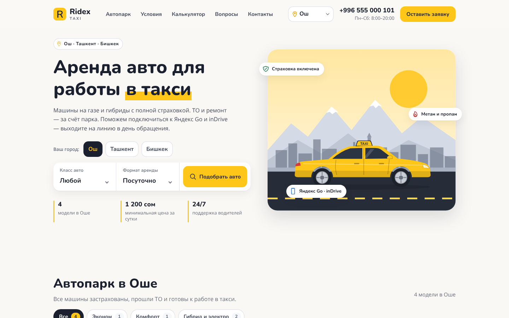

<div align="center">

  <h2 align="center">Ridex Taxi — аренда авто для такси</h2>

  Сайт таксопарка: аренда автомобилей для работы в такси в <b>Оше</b>, <b>Ташкенте</b> и <b>Бишкеке</b>.<br />
  Адаптивный, без сборки и сервера: HTML, CSS и JavaScript.

</div>

<br />



### Что есть на сайте

* **Выбор города** (Ош / Ташкент / Бишкек). От города зависят автопарк, цены и валюта (сом или сум), залог, телефон, WhatsApp, Telegram и адрес офиса. Выбор запоминается в браузере, а ссылка вида `?city=tashkent` сразу открывает нужный город.
* **Автопарк** с фильтром по классу: эконом, комфорт, гибрид и электро. Карточки строятся из данных, силуэты машин — SVG, поэтому фотографии не нужны.
* **Форматы аренды**: посуточно, неделя или месяц со скидкой, аренда с выкупом.
* **Калькулятор дохода**: машина, формат аренды, рабочие дни, доход за смену и топливо → сколько остаётся водителю за месяц.
* **Что входит в аренду**, **4 шага до выхода на линию**, **требования и документы**, **офисы**, **частые вопросы**.
* **Заявка**: форма проверяет поля и открывает WhatsApp менеджера выбранного города с готовым сообщением. Бэкенд не нужен.
* Плавающая кнопка WhatsApp, мобильное меню, доступность с клавиатуры.

### Как поменять цены, машины и контакты

Все данные лежат в одном файле — [`assets/js/data.js`](./assets/js/data.js):

* `cities` — для каждого города: телефон, номер WhatsApp (только цифры), Telegram, адрес, часы работы, залог, валюта, стартовые значения калькулятора и расход топлива за смену.
* `cars` — автопарк. `prices` — цена за сутки по городам. Если города нет в `prices`, машина там не показывается. `body` — силуэт (`sedan` или `hatch`), `color` — цвет кузова.
* `formats` — скидки за неделю и месяц.

> ⚠️ Телефоны, адреса и цены в `data.js` — **примерные**. Перед публикацией замените их на реальные.
> Ссылку на Instagram нужно указать в футере файла `index.html`.

### Запуск

Откройте `index.html` в браузере или запустите локальный сервер:

```bash
git clone https://github.com/asadbek8364-oss/ridex.git
cd ridex
python3 -m http.server 8000
# открыть http://localhost:8000
```

Для публикации подойдёт GitHub Pages: *Settings → Pages → Deploy from a branch*.

### Благодарности

Сайт сделан на основе бесплатного шаблона [Ridex](https://github.com/codewithsadee/ridex) от codewithsadee.
